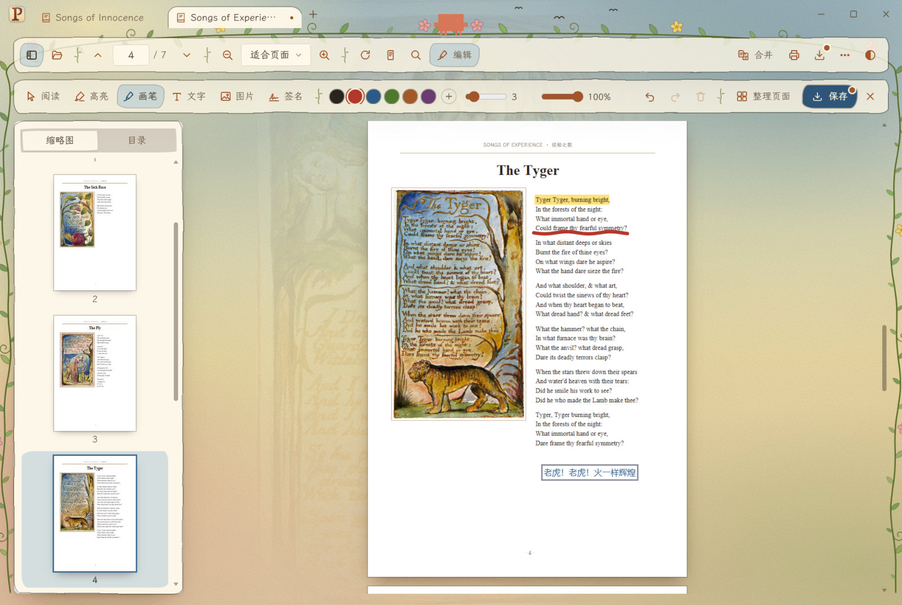
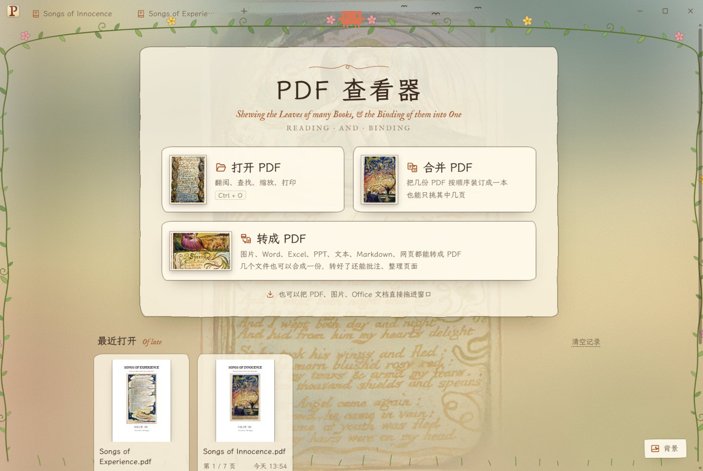
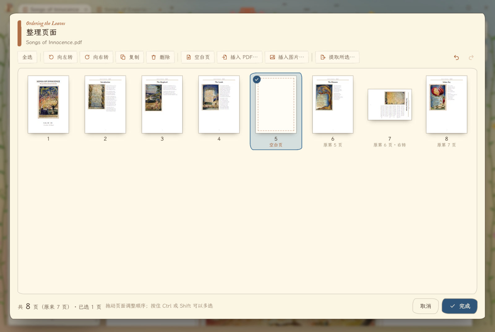
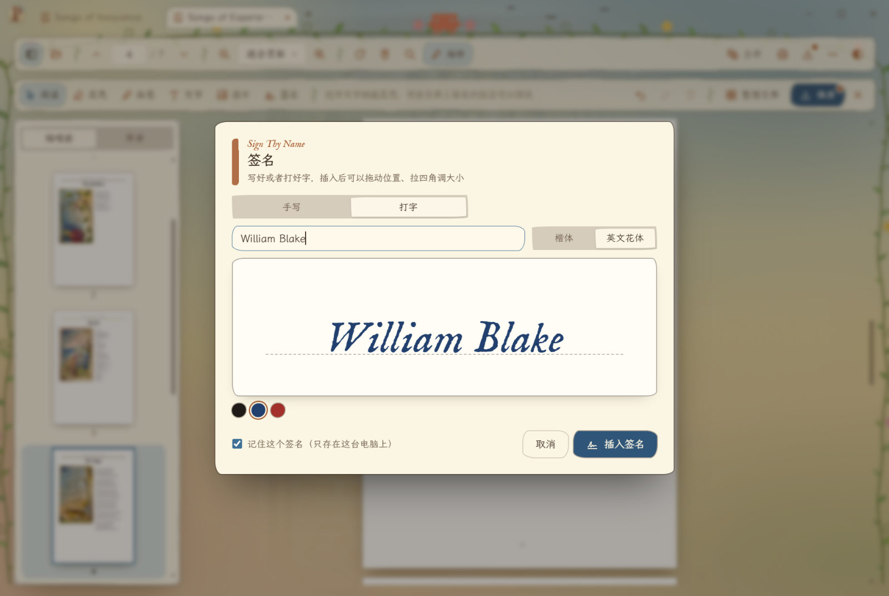
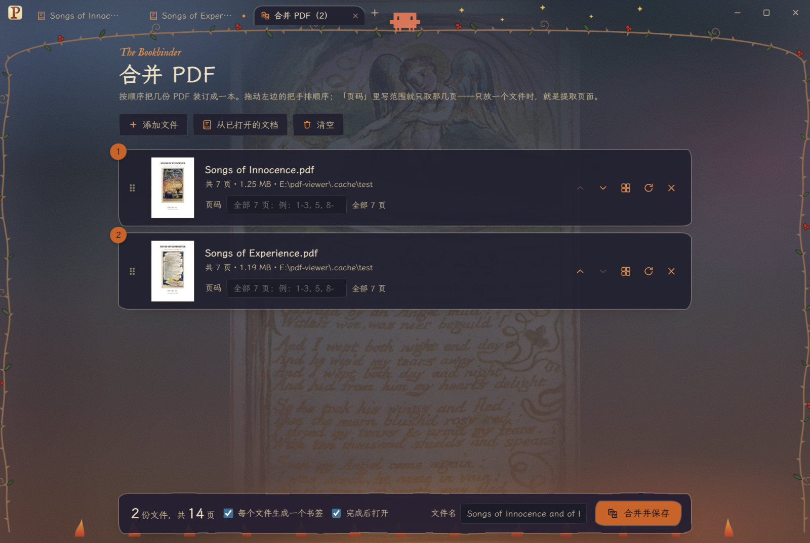
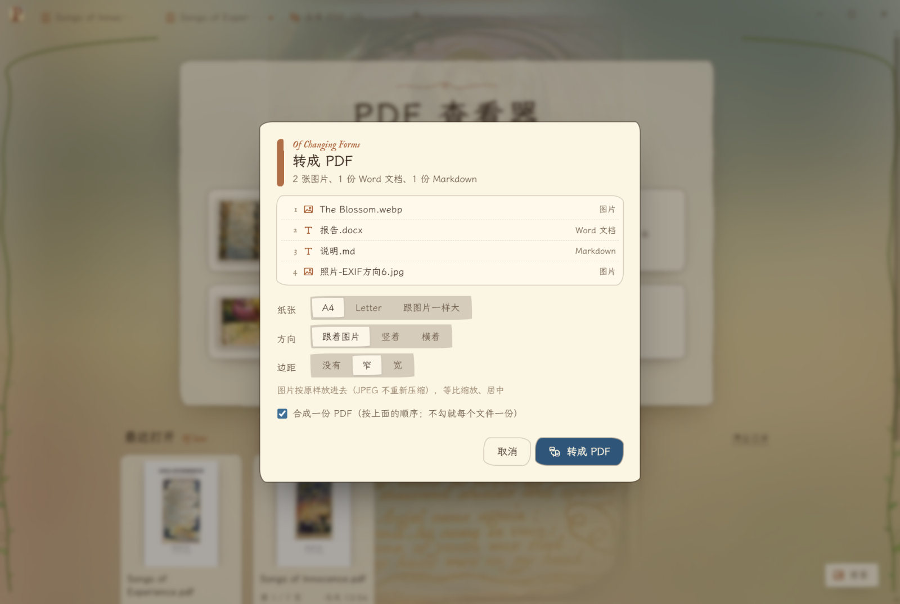
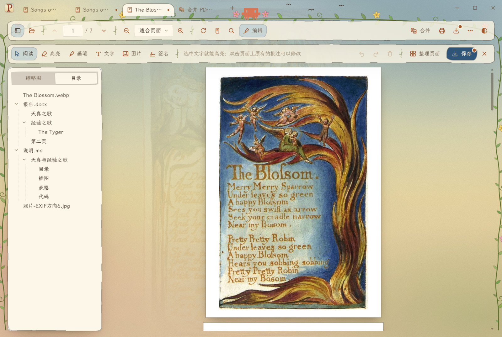
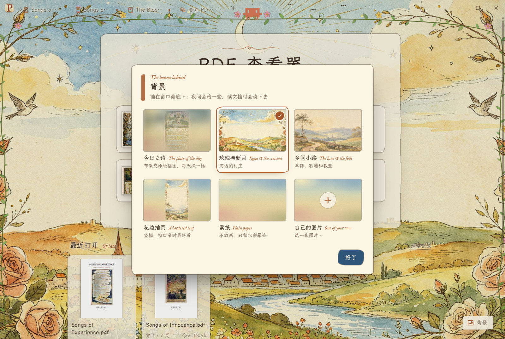
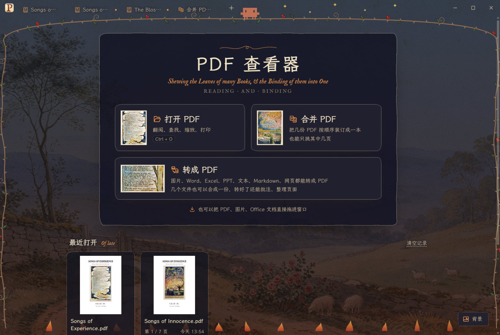

# PDF 查看器

威廉·布莱克《天真与经验之歌》插画风格的 PDF 查看器：阅读、批注、签名、整理页面、合并，还能把图片、Office 文档、文本和网页转成 PDF。
日间是「天真之歌」（晨光、水彩、花叶藤蔓），夜间是「经验之歌」（深夜、荆棘、星与火焰），拱顶上坐着 Claude Code 的小螃蟹 Clawd；
首页每天一首「今日之诗」，背景默认是那首诗的 Copy Z 原版插图（美国国会图书馆藏，公有领域），也可以换成三幅水彩画、素纸或者自己的图片。



桌面版用 [Tauri 2](https://tauri.app)（系统自带的 Edge WebView2，安装包约 15 MB）；`src/` 本身也是个纯静态网页，用浏览器打开也能用（保存改为下载）。

## 下载

在 [Releases](https://github.com/Riyel-Sinix/pdf-viewer/releases/latest) 里：

- **`PDF-Viewer_…_x64-setup.exe`**：安装版，装好后可以设为 .pdf 的默认打开方式（装在当前用户下，不需要管理员权限）；
- **`PDF-Viewer_…_x64-portable.exe`**：免安装，下载下来双击就能用。

需要 64 位 Windows 10 / 11，以及 Microsoft Edge WebView2 运行时（Windows 11 自带；没有的话安装版会自动下载）。
程序没有代码签名，第一次运行时 Windows 可能提示「Windows 已保护你的电脑」，点「更多信息」→「仍要运行」即可。
把 Office 文档转成 PDF 需要本机装有 Microsoft Office、WPS 或 LibreOffice 之一；转 HEIC 照片需要 Microsoft Store 里的「HEIF 图像扩展」和「HEVC 视频扩展」。

| 首页 | 整理页面 |
| --- | --- |
|  |  |
| **签名** | **合并（夜间「经验之歌」主题）** |
|  |  |
| **转成 PDF** | **转好的：几个文件合成一份，每个文件一个书签** |
|  |  |
| **背景：换成水彩「玫瑰与新月」** | **夜间：水彩压暗成夜色（「乡间小路」）** |
|  |  |

## 功能

- **阅读**：多标签页；缩略图 / 目录侧栏（F4）；页码跳转（也认页码标签，如 iv）；缩放（自动、适合宽度、适合页面、实际大小、50%–400%，Ctrl+滚轮以鼠标为中心）；
  顺时针 / 逆时针旋转（Ctrl+R / Ctrl+Shift+R）；版式（单页连续、双页、双页封面单独、单页翻页、平铺）；文字可选中复制；内部链接跳转，外部链接用系统浏览器打开；
  查找（Ctrl+F，F3 / Shift+F3 上下一个，区分大小写、整词）；页面色调（原色 / 纸色 / 夜读反色）；手形工具（按住空格临时切换）；
  演示模式（F5）；全屏（F11）；打印（Ctrl+P）；文档属性（Ctrl+D）；有密码的 PDF 会弹框输入密码；
  记住每份文档读到哪一页、缩放和旋转；首页列出最近打开的文件（带封面和阅读进度）。
- **编辑（Ctrl+E 打开编辑栏）**：用的是 pdf.js 自带的批注编辑器，存下来是标准的 PDF 批注，别的阅读器也认。
  - 批注：高亮（选中文字后点浮出的「高亮」，或者在编辑栏里选高亮再拖选；没有文字的地方可以随手涂）、画笔、文字框、图片（选文件、拖进窗口、粘贴都行，拖进来的放在鼠标松开的地方）、签名。
    颜色、粗细、浓淡、字号在编辑栏里调，选中某条批注时改的是它；选中后可拖动、拉四角改大小、Delete 删除。撤销 / 重做是 Ctrl+Z / Ctrl+Y。
  - 签名：手写（手写笔有压感，鼠标按快慢出粗细）或者打字（楷体 / 英文花体），可以记住最多 6 个常用的（只存在本机）。插到页面上是透明底的图片。
  - 整理页面（编辑栏右侧，或缩略图右键）：所有页铺成缩略图，拖动排序，旋转、复制、删除，插入空白页、别的 PDF（有密码的也行）、图片，提取所选页另存；
    都能撤销，点「完成」才生效（完成后在阅读页里还能 Ctrl+Z 撤回整次整理）。重排用 pdf.js 的 `extractPages`，书签、链接、表单、批注都留着；
    复制出来的页不带重复书签。旋转和空白页在后台线程里用 pdf-lib 补上——所以对带密码的文件转页或加空白页后，保存的结果不再加密（界面上会提示）。
  - 保存：Ctrl+S 写回原文件（先写临时文件再替换，不会写坏），Ctrl+Shift+S 另存为。有没保存的修改时，标签页和标题上有个小点；关标签或关窗口前会问要不要保存。
- **合并（Ctrl+M）**：添加文件（多选、拖进窗口、或从已打开的文档里选）；拖动把手排顺序；每个文件可以填页码范围（`1-3, 5, 8-`、`10-1` 倒序、`奇数`、`偶数`，全角标点也行）
  或者看缩略图挑页；整份旋转；每个文件生成一个书签（原有书签收在它下面）；完成后可直接打开。只放一个文件并填页码，就是「提取页面」。
  拼页用的是 pdf.js 6 自带的 `extractPages`（Firefox 合并功能用的同一套）：加了密码的 PDF 输入密码后也能合并，结果不带密码；原文件的书签、链接、表单都会保留。
- **转成 PDF**（首页「转成 PDF」、⋯ 菜单，或者直接把文件拖进窗口、用「打开」选）：转好的开成新标签页，可以接着批注、整理页面；还没存成文件，保存时默认放在源文件旁边。
  - 图片：JPEG、PNG、WebP、GIF、BMP、AVIF、ICO、SVG；桌面版还有 TIFF（多页扫描件一页一页放）、HEIC、JPEG XR（用 Windows 自带的 WIC 解码）。
    一张图一页，JPEG 原样放进去不重新压缩、PNG 无损；照片按 EXIF 方向摆正；纸张 A4 / Letter / 跟图片一样大（按图片里记的分辨率），方向、边距可选。
  - Office 文档（桌面版）：Word（doc、docx、rtf、odt、wps）、Excel（xls、xlsx、ods、et）、PowerPoint（ppt、pptx、odp、dps）。
    在后台用本机装的 Microsoft Office 转，没有的话用 WPS，再没有就用 LibreOffice；不弹窗口、不运行宏，Word 的标题会变成书签。设了打开密码的文档转不了（会提示）。
  - 文本、Markdown、CSV / TSV、网页（桌面版，.html、.mht 网页存档）：排好版后在看不见的窗口里打印成 PDF。A4，页脚有页码；Markdown 和网页的标题变成书签；
    文本自动认 UTF-8 / GBK；代码用等宽字体，长行自动换行；CSV 的表头每页都有，列多时自动横排。网页打印时不运行里面的脚本、也不会跳到别的网址。
  - 几个文件一起转：可以合成一份（按文件名排序；混着放时每个文件一个书签，原来的书签收在它下面），也可以每个文件一份。拖进合并页的图片、文档会先转成 PDF 再加入。
  - **右键菜单**（桌面版）：在资源管理器里右键图片、Office 文档、Markdown、CSV、网页或 .txt，点「转成 PDF」，转好直接存在原文件旁边（同名的 PDF 已经有了就存成「名字 (1).pdf」，不覆盖），
    再在程序里打开；可以多选（一次最多 100 个），程序没开着也行。安装版装好就有，免安装版在 ⋯ 菜单里打开「资源管理器右键菜单里的「转成 PDF」」；
    都可以在那里关掉（关掉后重新安装也不会再加回来）。原文件夹存不进去时（只读之类），转好的开成没保存的标签页。
    Windows 11 上，安装时会问一次管理员权限（UAC）：同意了，「转成 PDF」就在右键菜单第一层；不同意、静默安装或免安装版，它在「显示更多选项」里。
  - 网页版只能转图片（Office、文本、网页的转换要靠本机的 Office 和 WebView2）。
- **背景**（首页右下角「背景」、⋯ 菜单「换背景…」，或在首页空白处右键）：今日之诗（默认，布莱克原版插图，每天换一幅）；三幅水彩——玫瑰与新月、乡间小路、花边插页
  （和 Chrome 主题 [chrome-blake-theme](https://github.com/Riyel-Sinix/chrome-blake-theme) 同一套图）；素纸（不放画）；或者自己选一张图片（缩到长边 2560 存在本机）。
  点一下就换上，记在本机；夜间主题把画压暗成夜色，读文档时淡下去。
- **桌面集成**：可设为 .pdf 的默认打开方式；程序开着时再从资源管理器打开 PDF，会在同一个窗口里开新标签页；文件可直接拖进窗口。

## 目录

| 路径 | 作用 |
|---|---|
| `src/index.html` | 页面骨架（工具栏、侧栏、阅读区、合并页） |
| `src/css/app.css` | 全部样式 |
| `src/js/main.js` | 主控：标签页、视图切换、工具栏、菜单、快捷键、拖放、粘贴 |
| `src/js/reader.js` | 阅读器：每个标签页一个 pdf.js PDFViewer（「叶」，切标签时没保存的批注不会丢）；侧栏、查找、缩放、版式、演示、打印、属性、批注编辑器 |
| `src/js/editbar.js` | 编辑栏：工具、颜色粗细（放不下时按实际宽度一级级收紧）、撤销重做、整理页面、保存 |
| `src/js/sign.js` | 签名对话框：手写板、打字、存着的签名 |
| `src/js/organize.js` / `pages-worker.js` | 整理页面对话框；按页面清单重新生成文档，后台线程里用 pdf-lib 转页、加空白页、去掉副本带进来的重复书签 |
| `src/js/merge.js` / `merge-worker.js` | 合并：列表、页码范围、挑页；后台线程里用 pdf-lib 加书签、旋转 |
| `src/js/convert.js` / `convert-worker.js` | 转成 PDF：认文件类型、选项对话框、图片解码、把文本 / Markdown / CSV 排成网页；后台线程里用 pdf-lib 把图片拼成 PDF、修正打印出来的书签标题 |
| `src/js/home.js` | 首页、最近打开、今日之诗 |
| `src/js/backdrop.js` | 背景：今日之诗、水彩画、素纸、自己的图片（存进 IndexedDB）和选择框 |
| `src/js/vines.js` | 页边藤蔓和 Clawd |
| `src/js/platform.js` | 桌面版 / 网页版的差别（读写文件、对话框、窗口按钮） |
| `src/vendor/` | pdf.js 6.4.299、pdf-lib 1.17.1、marked 18.1.2（`npm run vendor` 从 node_modules 拷过来） |
| `src/assets/` | 字体子集、纸纹、45 幅原版插图、背景水彩（`backdrops/`，`t/` 是选择框里的小图）、图标 |
| `src-tauri/` | 桌面外壳（Rust）：文件读写、系统对话框、单实例、文件关联；`src/convert.rs` 是转换里靠本机的部分（Office 转换、隐藏窗口打印成 PDF、WIC 解码图片），`src/office.ps1` 是驱动 Office / WPS / LibreOffice 的 PowerShell 脚本；`src/shell_menu.rs` 是资源管理器右键菜单（旧式的写当前用户的注册表；Windows 11 第一层的登记、去掉包），`windows/hooks.nsh` 让安装包装好时加上、卸载时删掉；`shell-menu/` 是 Windows 11 右键菜单第一层的组件（IExplorerCommand 的 DLL、稀疏包清单，包的身份在 `package/identity.json`） |
| `tools/` | `vendor.mjs`、`fonts.py`（字体子集）、`serve.mjs`（预览服务器）、`preview-helpers.js`（预览里测编辑的小工具）、`icon/`（图标源文件）、`make-backdrops.py`（背景水彩）、`make-test-pdfs.py` / `make-named-dests.py` / `make-showcase-pdf.py`（测试和截图用的 PDF）、`make-convert-tests.py`（转换用的各种测试文件）、`desktop-smoke.mjs` / `convert-smoke.mjs` / `shell-menu-smoke.mjs`（桌面版冒烟测试）、`build-shell-menu.mjs`（编译 Windows 11 右键组件、打包成 .msix）/ `shell-menu-e2e.mjs`（它的端到端测试）、`screenshots.mjs`（README 截图）、`third-party.mjs`（Rust 依赖的许可证清单）、`l10n/`（pdf.js 编辑器的中文界面文字，MPL 2.0） |
| `docs/` | README 里的截图 |

## 构建

需要 Node.js、Rust（MSVC 工具链）、Windows SDK（打 Windows 11 右键菜单的 .msix 要用里面的 makeappx，Visual Studio 生成工具里勾「Windows SDK」）。编译缓存在 `src-tauri/target/`。

```bash
npm install
npm run vendor          # 升级 pdf.js / pdf-lib / marked 后重跑
npx tauri build         # 产物：src-tauri/target/release/pdf-viewer.exe 和 bundle/nsis/ 下的安装包
```

`npx tauri build` 先自动跑 `node tools/build-shell-menu.mjs`：编译右键组件 DLL（`src-tauri/shell-menu`），把稀疏包清单打成 `PDFViewer.ShellMenu.msix`，
安装包把两样都放进安装文件夹的 `shell-menu\`。这个包没签名（发布者带微软规定的 OID），是 Windows 11 给「没签名的包」开的口子：
登记要管理员，按微软的说法包会装给这台电脑的所有用户，微软建议只用来测试、不要大范围分发。所以只在安装时问一次，用户拒绝就退回旧式菜单；
登记、去掉的结果记在 `%TEMP%\pdf-viewer-shell-menu.log`。只有改了 `AppxManifest.xml` 才要把 `identity.json` 的 version 加一，
安装包看到登记的版本不同才会重新登记（再问一次管理员）；程序和 DLL 更新不用改它。

- 只想在浏览器里看界面：`node tools/serve.mjs`，然后打开 http://127.0.0.1:8780/ （`/__test/` 下是 `.cache/test` 里的测试 PDF，用 `python -P tools/make-test-pdfs.py` 生成）。
- 背景水彩：`python -P tools/make-backdrops.py [chrome-blake-theme 的 source 文件夹]`，从 Chrome 主题的原图裁掉白边、缩到长边 2560，再做选择框里的小图，输出到 `src/assets/backdrops/`。
- 字体：霞鹜文楷取 GB2312 全部汉字 + 界面用到的字，`python -P tools/fonts.py`（源字体放 `.cache/fonts/`）；子集化后的字体内部改名为 Songs Han / Songs Fell（两套字体都有 OFL 保留字体名）。文件名里的生僻字会退回系统楷体。
- 图标：手工上色风格的首字母「P」，字形取自界面字体 IM FELL English。`python -P tools/icon/make-icon.py` 生成 `tools/icon/p-blake.svg`（完整版）和 `p-blake-small.svg`（16–32 像素用的简化版），
  用无头 Edge 渲染，再 `npx tauri icon` 出全套；`icon.ico` 里 16–32 像素放简化版（细藤蔓缩小了会糊），界面左上角的 `src/assets/icon-*.png` 也一起生成。
- 自动化测试：设环境变量 `PDFVIEWER_TEST_OFFSCREEN=1`，窗口会开在屏幕外、不抢焦点。`node tools/desktop-smoke.mjs` 跑一遍桌面版（打开、合并、编辑、存盘、整理页面、签名、粘贴、关窗确认、背景），截图在 `.cache/shots/`。
- 转换测试：`python -P tools/make-convert-tests.py` 在 `.cache/test/convert/` 生成各种格式的测试文件（要 Pillow、python-docx、openpyxl；PPT 用本机的 PowerPoint 生成，没装就跳过），
  再 `node tools/convert-smoke.mjs`（拖放转换、合成一份、拖进合并页、存盘、隐藏窗口有没有关掉）。本机没装 Office / WPS / LibreOffice 时 Office 那几项跳过。
- 右键菜单测试：`node tools/shell-menu-smoke.mjs`（安装程序用的注册 / 删除、像多选那样同时启动好几个 `--convert`、同名不覆盖、存不进去时的退路、⋯ 菜单的开关）。
  测试时程序把注册表写在单独的 `HKCU\Software\PDFViewerTest` 下、单实例也换了名字，不碰真正的右键菜单、不会转进用户正开着的窗口，测完删掉。
- Windows 11 第一层右键菜单的测试：`node tools/build-shell-menu.mjs --test && node tools/shell-menu-e2e.mjs`（要 Windows 11、开开发者模式，先 `npx tauri build`）。
  用测试专用的包名和 CLSID 登记一个稀疏包，像资源管理器那样通过 COM 代理调「转成 PDF」，看程序收到的参数、它写的文件落没落在平常的位置；
  再换上真正的程序试安装包用的 `--shell-package-needed` / `--register-shell-menu` / `--add-shell-package` / `--remove-shell-package`。要管理员的那一步只能用安装包测。
- README 截图：`python -P tools/make-showcase-pdf.py`（用插图和诗生成两册示例），再 `node tools/screenshots.mjs`，结果在 `docs/`。画笔、文字批注用 DevTools 的 `Input.dispatchMouseEvent` 发真正的鼠标事件——pdf.js 按事件的 offsetX/offsetY 定位，网页里自己造的指针事件位置不准。
- 浏览器预览里测编辑：`import('/__test/helpers.js')` 有画批注、喂文件选择框、拦下载的小工具；`PUT /__out/名字` 会把页面里生成的文件存到 `.cache/out/`，方便用 PyMuPDF（`python -P`）检查。
- 注意：pdf-lib 1.17 的 `removePage` 不刷新页面缓存（`getPages()` 还带着删掉的页），所以两个 worker 都把「删掉临时加的那一页」放在最后做。
- 注意：WebView2 打印成 PDF 时，标题被挤到下一页重新排版（后面跟着放不下的大图之类）的书签标题会重复（「插图」变成「插图插图」），`convert-worker.js` 照网页里的标题改回来；
  MHT 网页存档的换行必须是 CRLF（只有 LF 的印出来是白纸），`convert.rs` 会先换好再打印。
- 第三方许可证：改了 Rust 依赖后跑 `node tools/third-party.mjs` 重新生成 `licenses/rust-crates*`。

## 许可

本项目的代码以 [MIT 许可证](LICENSE) 发布。pdf.js、pdf-lib、marked、两套字体、Rust 依赖等第三方组件沿用各自的许可证，见 [THIRD_PARTY_NOTICES.md](THIRD_PARTY_NOTICES.md)；
《天真与经验之歌》的插图和诗是公有领域；背景水彩画（`src/assets/backdrops/`）由本项目作者提供，和 Chrome 主题 chrome-blake-theme 是同一套图。
